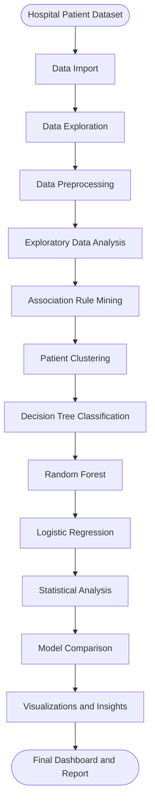
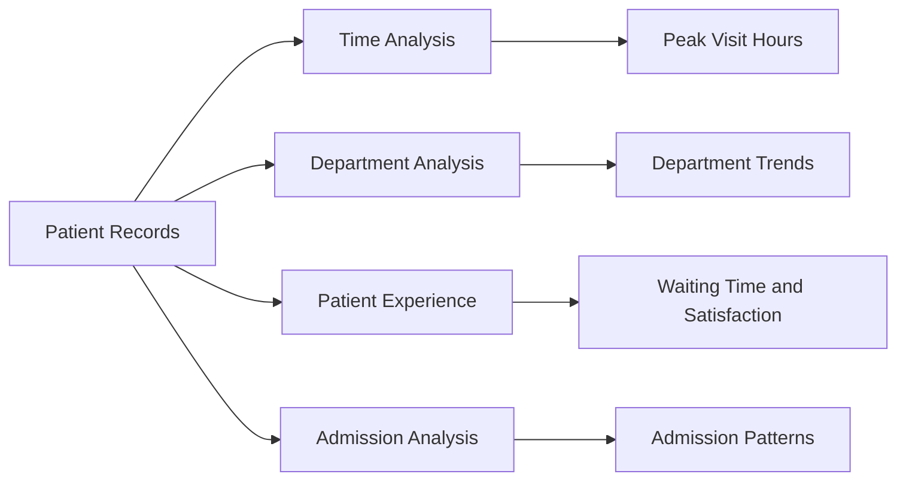

<div align="center">

# 🏥 HOSPITAL PATIENT VISIT PATTERN ANALYSIS

### Data Mining • Statistical Analysis • Machine Learning • Healthcare Analytics

**Transforming hospital visit records into meaningful insights through R programming, data mining, and predictive analytics.**

[](https://www.r-project.org/)
[](https://en.wikipedia.org/wiki/Data_mining)
[](https://en.wikipedia.org/wiki/Machine_learning)
[](https://ggplot2.tidyverse.org/)
[](https://posit.co/products/open-source/rstudio/)

**An end-to-end healthcare data analytics project built using R.**

</div>

---

## 🧠 01. Project Overview

**Hospital Patient Visit Pattern Analysis** is a data mining and analytics project that studies hospital patient visits to identify meaningful patterns, understand patient behaviour, analyze hospital performance, and explore factors associated with patient admission.

The project uses R programming to perform data preprocessing, exploratory data analysis, association rule mining, clustering, statistical testing, and machine learning.

It transforms raw hospital visit records into visual insights, statistical summaries, and predictive models.

### 🎯 Project Objectives

- Analyze patient visits across different days, months, and departments.
- Identify peak hospital hours and seasonal visit patterns.
- Understand waiting time and patient satisfaction.
- Discover relationships between diagnoses, departments, and admissions.
- Group patients using clustering techniques.
- Predict hospital admission using machine learning.
- Compare different predictive models.
- Identify important factors associated with hospital admissions.

---

## 🧬 02. Project Highlights

| Category | Implementation |
|---|---|
| Programming | R |
| Data Processing | Data Cleaning and Transformation |
| Visualization | ggplot2, corrplot |
| Association Mining | Apriori Algorithm |
| Clustering | K-Means, Hierarchical Clustering |
| Classification | Decision Tree, Random Forest |
| Statistical Analysis | Chi-Square, ANOVA, Correlation |
| Predictive Analysis | Logistic Regression |
| Model Evaluation | Confusion Matrix, ROC Curve, AUC |
| Dataset | Hospital Patient Visit Dataset |

---

## 🔬 03. Complete Analytical Workflow

The project follows a structured data mining pipeline.



---

## 📈 04. Data Analysis & Visualization

The project generates multiple visualizations to understand hospital operations and patient behaviour.

### 📅 Patient Visit Patterns

- Visits by day of the week.
- Monthly patient visit distribution.
- Department-wise patient visits.
- Visit type by time slot.
- Diagnosis distribution across seasons.
- Hospital peak-hour analysis.

### 🏥 Patient Experience Analysis

- Waiting time versus satisfaction score.
- Waiting time distribution by weekday.
- Patient bill distribution across departments.
- Consultation time analysis.
- Patient repeat-visit patterns.

### 📊 Statistical Visualizations

- Correlation heatmap.
- Department-wise box plots.
- Admission-related patterns.
- Diagnosis frequency analysis.
- Monthly patient visit trends.

### Visualization Workflow



---

## 🤖 05. Data Mining & Machine Learning

This project implements multiple data mining and machine learning techniques.

### 1. Association Rule Mining — Apriori

Discovers relationships between different hospital visit attributes.

**Used to explore:**
- Department and diagnosis combinations.
- Visit type and admission patterns.
- Seasonal diagnosis relationships.
- Factors frequently occurring together.

**Important metrics:**
- Support
- Confidence
- Lift

### 2. K-Means Clustering

Groups patients into three clusters based on numerical characteristics.

**Features used:**
- Age
- Distance travelled
- Waiting time
- Consultation time
- Length of hospital stay
- Total bill amount

The elbow and silhouette methods are used to examine suitable cluster counts.

### 3. Hierarchical Clustering

Uses Ward's method to create a hierarchical grouping of patients.

A dendrogram is generated to visualize relationships between clusters.

### 4. Decision Tree

Builds a classification model to predict whether a patient will be admitted.

The dataset is divided into training and testing subsets.

### 5. Random Forest

Uses multiple decision trees to improve classification performance and examine variable importance.

### 6. Logistic Regression

Analyzes the relationship between selected patient characteristics and hospital admission.

---

## 🧪 06. Statistical Analysis

The project also uses statistical techniques to investigate relationships in hospital data.

| Technique | Purpose |
|---|---|
| Chi-Square Test | Examine relationships between categorical variables |
| ANOVA | Compare waiting times across weekdays |
| Correlation Test | Study the relationship between waiting time and satisfaction |
| Correlation Matrix | Understand relationships among numerical variables |
| Outlier Detection | Identify unusually high or low values |

---

## 🏆 07. Machine Learning Model Evaluation

Three classification models are compared:

- Decision Tree
- Random Forest
- Logistic Regression

The following evaluation metrics are calculated:

| Metric | Meaning |
|---|---|
| Accuracy | Overall correct predictions |
| Sensitivity | Correctly identified admitted patients |
| Specificity | Correctly identified non-admitted patients |
| Precision | Reliability of positive admission predictions |
| AUC | Ability to distinguish between admission classes |

**ROC Curve Comparison**

The project compares Decision Tree and Random Forest using ROC curves and AUC values.

The final model comparison table also includes Logistic Regression.

---

## 📊 08. Key Performance Indicators (KPIs)

The analysis calculates important hospital performance indicators:

- Total patient visits.
- Number of unique patients.
- Average patient age.
- Average waiting time.
- Average consultation time.
- Hospital admission rate.
- 30-day readmission rate among admitted patients.
- Average hospital bill.
- Average patient satisfaction score.
- Busiest day, month, and department.

These indicators help summarize hospital activity and patient experience.

---

## 🖥️ 09. Interactive Dashboard & Project Deliverables

The repository includes the following deliverables:

| Deliverable | Description |
|---|---|
| R Analysis Script | Complete 23-step data analysis workflow |
| Excel Dataset | Hospital patient visit records |
| HTML Dashboard | Interactive dashboard for exploring analysis |
| PDF Report | Project methodology and analysis |
| Code Output PDF | Analysis code and generated figures |
| PPT Presentation | Project presentation |

### Explore the Project

- 📊 [Interactive HTML Dashboard](https://github.com/Ramssmb/dma-lab-project/blob/main/Hospital%20Patient%20Visit%20Pattern%20Dashboard.html)
- 📄 [Project Report](https://github.com/Ramssmb/dma-lab-project/blob/main/Hospital_Patient_Visit_Pattern_Analysis_Report.pdf)
- 📈 [Analysis Code and Figures](https://github.com/Ramssmb/dma-lab-project/blob/main/Hospital_Visit_Analysis_Code_Output_Figures.pdf)
- 🎤 [Project Presentation](https://github.com/Ramssmb/dma-lab-project/blob/main/Hospital_Patient_Visit_Pattern_Analysis%20(1).pptx)

---

## 🛠️ 10. Technologies & Libraries

### Programming Environment

- **R Programming:** Main language used for data analysis.
- **RStudio:** Development environment.

### R Libraries

| Library | Purpose |
|---|---|
| `readxl` | Import Excel datasets |
| `dplyr` | Data manipulation |
| `ggplot2` | Data visualization |
| `arules` | Association rule mining |
| `arulesViz` | Association rule visualization |
| `cluster` | Clustering algorithms |
| `factoextra` | Cluster visualization |
| `rpart` | Decision tree |
| `rpart.plot` | Decision tree plotting |
| `caret` | Model training and evaluation |
| `corrplot` | Correlation visualization |
| `randomForest` | Random Forest classification |
| `pROC` | ROC curve and AUC analysis |

---

## ⚙️ 11. Installation & Setup

### Prerequisites

- R programming language
- RStudio
- Hospital Patient Visit Dataset

### Step 1: Clone the Repository

```bash
git clone https://github.com/Ramssmb/dma-lab-project.git
cd dma-lab-project
```

### Step 2: Open RStudio

Open the following R script:

```text
Hospital_Visit_Analysis.R
```

### Step 3: Install Required Packages

Run the following command in RStudio:

```r
install.packages(c(
  "readxl",
  "dplyr",
  "ggplot2",
  "arules",
  "arulesViz",
  "cluster",
  "factoextra",
  "rpart",
  "rpart.plot",
  "caret",
  "corrplot",
  "randomForest",
  "pROC",
  "rstudioapi"
))
```

### Step 4: Run the Analysis

Open the R script and execute it using:

```r
source("Hospital_Visit_Analysis.R")
```

Alternatively, select all the code and press:

```text
Ctrl + Enter
```

### Step 5: Select the Dataset

When prompted, select:

```text
Hospital_Patient_Visit_Dataset.xlsx
```

Make sure the Excel workbook contains the `Patient_Visits` sheet.

### Step 6: Explore Results

The script generates:

- Statistical summaries.
- Data visualizations.
- Association rules.
- Patient clusters.
- Machine learning predictions.
- Model evaluation results.

---

## 🗂️ 12. Repository Structure

```text
dma-lab-project/
│
├── Hospital_Visit_Analysis.R
│   └── Complete R data analysis script
│
├── Hospital_Patient_Visit_Dataset.xlsx
│   └── Hospital patient visit dataset
│
├── Hospital Patient Visit Pattern Dashboard.html
│   └── Interactive dashboard
│
├── Hospital_Patient_Visit_Pattern_Analysis_Report.pdf
│   └── Project documentation
│
├── Hospital_Visit_Analysis_Code_Output_Figures.pdf
│   └── Code execution and visualizations
│
├── Hospital_Patient_Visit_Pattern_Analysis (1).pptx
│   └── Project presentation
│
├── .RData
│   └── R workspace data
│
├── .Rhistory
│   └── R command history
│
└── README.md
    └── Project documentation
```

---

## 🔍 13. Analytical Pipeline — 23 Steps

The R script is organized into 23 analytical steps:

| Step | Analysis |
|---:|---|
| 01 | Install and load packages |
| 02 | Import hospital dataset |
| 03 | Explore data |
| 04 | Data preprocessing |
| 05 | Patient visit pattern analysis |
| 06 | Association rule mining |
| 07 | K-Means clustering |
| 08 | Decision tree classification |
| 09 | Monthly visit trends |
| 10 | Outlier detection |
| 11 | Correlation analysis |
| 12 | Peak-hour heatmap and top diagnoses |
| 13 | Statistical tests |
| 14 | Random Forest classification |
| 15 | Model comparison using ROC curves |
| 16 | Logistic regression |
| 17 | Hierarchical clustering |
| 18 | Hospital KPI summary |
| 19 | Department and visit type summary |
| 20 | Time and seasonal patterns |
| 21 | Repeat visits and readmission analysis |
| 22 | Model comparison table |
| 23 | Top association rules and cluster summary |

---

## 💡 14. Key Learning Outcomes

Through this project, the following concepts were implemented:

- Real-world dataset handling using R.
- Data cleaning and preprocessing.
- Exploratory data analysis.
- Data visualization and interpretation.
- Association rule mining.
- Unsupervised machine learning.
- Supervised machine learning.
- Statistical hypothesis testing.
- Predictive model evaluation.
- Healthcare data interpretation.

---

## 🚀 15. Future Enhancements

- [ ] Add real-time hospital data integration.
- [ ] Develop an advanced interactive dashboard.
- [ ] Add patient admission risk visualization.
- [ ] Improve model performance through hyperparameter tuning.
- [ ] Add advanced patient readmission prediction.
- [ ] Add automated data preprocessing.
- [ ] Implement downloadable analytical reports.
- [ ] Deploy the dashboard online.

---

## ⚠️ 16. Important Note

This project is an educational data mining and analytics implementation.

The analysis and predictive models are intended for learning and exploration. They are not clinically validated and should not be used to make real-world medical or hospital admission decisions.

---

## 👨‍💻 17. Project Credits

**Project:** Hospital Patient Visit Pattern Analysis Using Data Mining

**Mentor:** Dr. Jagdeep Kaur

**Contributors:**
- M Srihari
- M Bhavsingh

**GitHub Repository:**

[Ramssmb/dma-lab-project](https://github.com/Ramssmb/dma-lab-project)

---

<div align="center">

## ⭐ Turning Healthcare Data into Meaningful Insights

**Explore. Analyze. Discover. Predict.**

If you find this project interesting, consider giving the repository a ⭐.

**Built with R | Data Mining | Statistical Analysis | Machine Learning**

</div>
